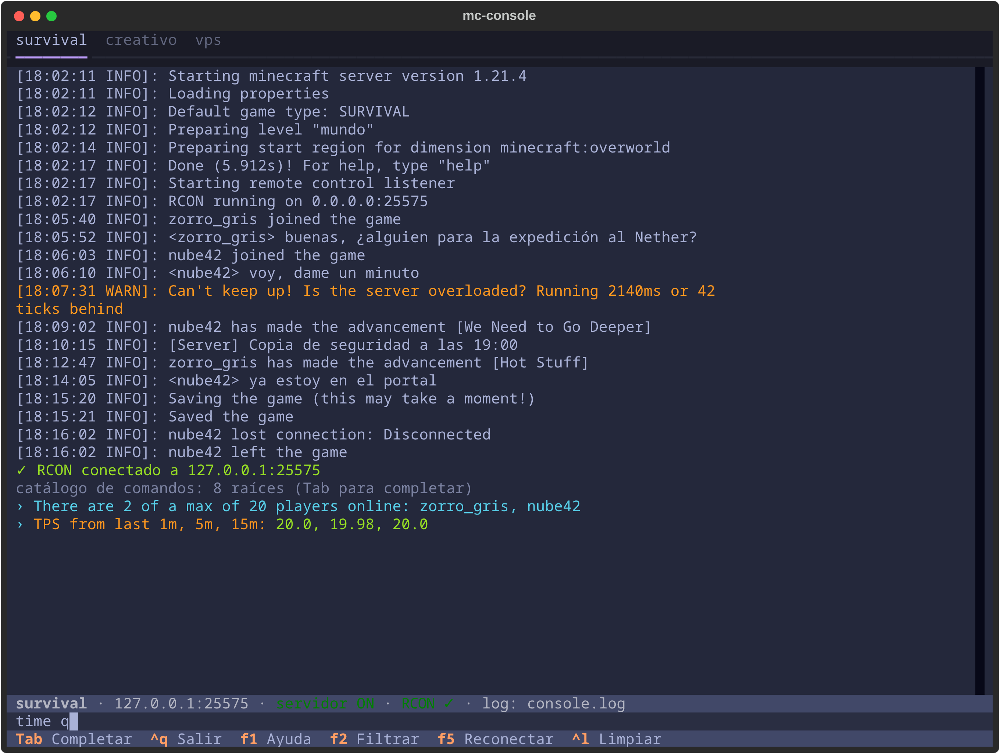
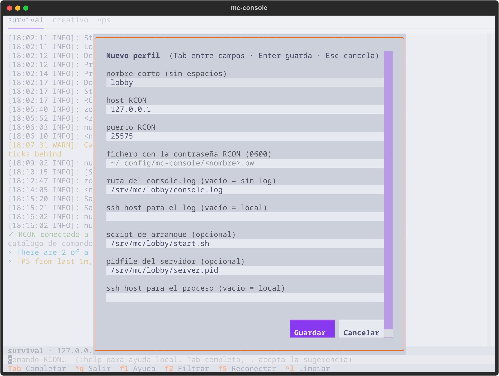
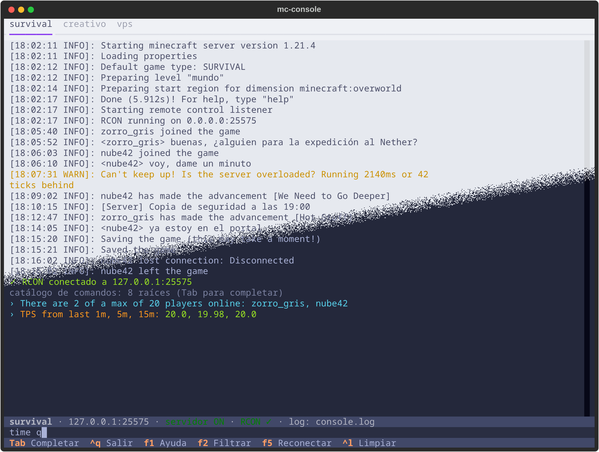

<div align="center">

# McConsole

**Consola de terminal para servidores de Minecraft: log en vivo, RCON y control del proceso.**


</div>

---

## Qué es

McConsole es la consola que le falta a un servidor de Minecraft que corre en segundo plano, en tu
máquina o en un VPS. Junta en una sola pantalla el log en vivo, los comandos por RCON y el
arranque y la parada del proceso, con una pestaña por servidor. Trae dos interfaces sobre el
mismo núcleo: `mc-console`, una TUI para personas, y `mc-rcon`, una CLI de salida limpia para
scripts y agentes. Las dos pueden usarse a la vez sobre el mismo servidor.

<p align="center">
  
  &nbsp;
  
  &nbsp;
  
</p>

<p align="center"><sub>Servidor de ejemplo con datos inventados. Las capturas se regeneran con <code>tools/capturas/capturas.sh</code>.</sub></p>

## Funciones principales

- **Log en vivo** de un archivo local, por `ssh` (`tail -F`) o por SFTP, para paneles sin shell.
  Sigue los reinicios y no te baja al final si estás leyendo más arriba.
- **Comandos RCON** con historial, búsqueda y autocompletado de los comandos del servidor,
  incluidos los de mods y plugins.
- **Control del proceso**: `:start`, `:stop`, `:restart` y `:status`, en local o por SSH.
- **Varios servidores** en pestañas que se conectan la primera vez que las abres.
- **Gestión de mundos** (`:world`): listar, crear con los presets que tenga el servidor, cambiar,
  renombrar, mandar a la papelera y respaldar.
- **Modo máquina** (`mc-rcon`): sin colores, con `--json`, `--log-wait` y códigos de salida estables.
- Filtro del log, selección con copia automática al portapapeles y `:ip` para saber a qué
  dirección conectarse.

## Tecnologías

| Capa | Tecnología |
|---|---|
| Interfaz | [Textual](https://textual.textualize.io/) (TUI) y `argparse` (CLI) |
| Protocolo | cliente RCON propio (protocolo Source) |
| Remoto | `ssh` del sistema; `paramiko` para SFTP (extra opcional) |
| Mundos | lector NBT propio, sin dependencias |
| Pruebas | `pytest` con el `Pilot` de Textual y un servidor RCON simulado |

## Puesta en marcha

```bash
uv tool install .              # o: pipx install .   ·   con SFTP: uv tool install '.[sftp]'
mc-console --init              # crea ~/.config/mc-console/servers.toml de ejemplo
mc-console                     # abre la consola con todos los perfiles
mc-rcon -p survival "list"     # un comando desde un script
```

Para desarrollar: `uv sync --extra dev` y `uv run pytest`.

## Documentación

La guía completa (perfiles, atajos, mundos, script de arranque y modo máquina) está en
[`docs/guia.md`](docs/guia.md). Las decisiones de diseño, en [`docs/decisiones/`](docs/decisiones/).

## Licencia

Código bajo **GPL-3.0-or-later** ([`LICENSE`](LICENSE)). Los componentes de terceros y sus licencias
están en [`NOTICE`](NOTICE). El nombre y la identidad visual no forman parte de la licencia: ver
[`TRADEMARKS.md`](TRADEMARKS.md). Para aportar, [`CONTRIBUTING.md`](CONTRIBUTING.md).

## Apoyo

Este proyecto forma parte del trabajo de **NoctiVulp**: herramientas para Linux y Android,
publicadas como software libre. Las compilaciones oficiales y las novedades salen en Patreon.

<p align="center">
  <a href="https://www.patreon.com/cw/NoctiVulp"></a>
</p>

---

<p align="center"><sub>© 2026 NoctiVulp · <b>Powered by AI</b> — desarrollado con la asistencia de Claude, de Anthropic.</sub></p>
